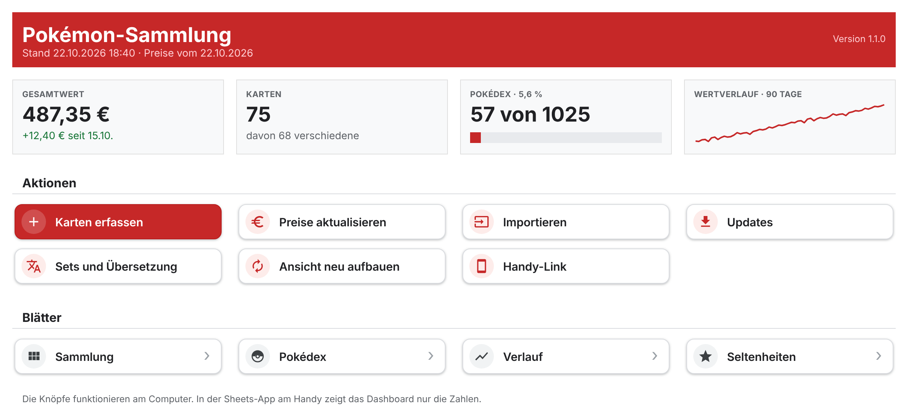
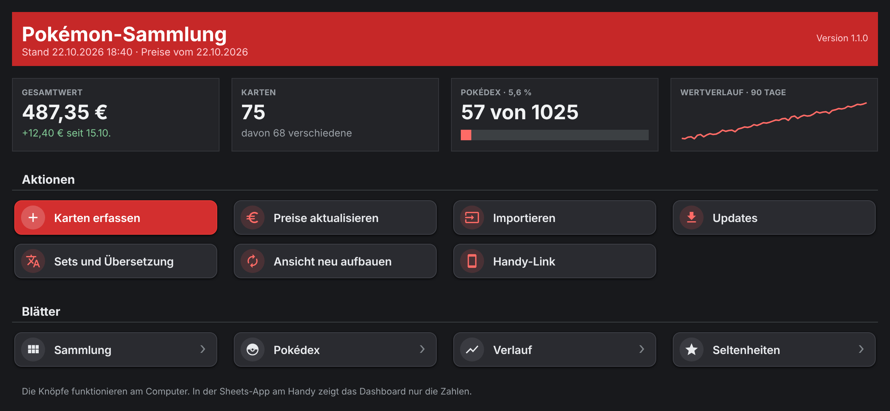
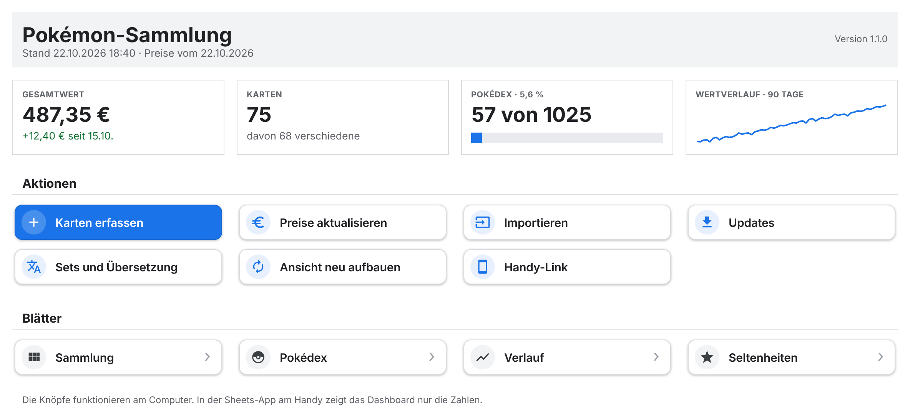

# Dashboard-Looks

Für das Blatt **Dashboard** (ab Version 1.1.0) gibt es drei Looks. Eric hat am 22.10.2026 **Rot-weiß** gewählt, nur diesen baut das Tool. **Dunkel** und **Hell-neutral** sind nicht im Script. Sie bleiben hier als Konzept gespeichert, falls später einer davon kommen soll.

Raster, Kacheln, Knöpfe und Texte sind bei allen drei gleich (beschrieben in [SPEC.md](../SPEC.md), Abschnitt 12), nur die Farben unterscheiden sich. Die Vorschauen zeigen Musterzahlen.

## Rot-weiß (aktiv)

Weiße Seite mit rotem Kopf (#c62828), hellgraue Kacheln, Akzent Rot. Die Aktionsknöpfe sind weiß mit rotem Symbol, „Karten erfassen“ ist rot gefüllt. Die Knöpfe unter „Blätter“ haben ein graues Symbol und einen Pfeil.

## Dunkel (gespeichert)

Fast schwarze Seite (#18191c) mit dem gleichen roten Kopf, dunkelgraue Kacheln mit heller Schrift, Akzent Hellrot (#ff6b66). Die Knöpfe sind dunkelgrau mit hellrotem Symbol, „Karten erfassen“ ist rot gefüllt. Plus und Minus stehen in hellem Grün und Rot, damit sie auf dem dunklen Grund lesbar bleiben. Dunkel wäre nur das Dashboard, die anderen Blätter der Tabelle bleiben hell.

## Hell-neutral (gespeichert)

Weiße Seite mit hellgrauem Kopf und dunkler Schrift, weiße Kacheln mit Rahmen, Akzent Blau (#1a73e8) wie in den Google-Apps. Die Knöpfe sind weiß mit blauem Symbol, „Karten erfassen“ ist blau gefüllt.

## Wo was steht

- [`looks.json`](looks.json): alle Farben je Look. `blatt` sind die Farben des Blatts (gleiche Namen wie `DASH_COLORS` in `src/Code.gs`), `knoepfe` die der Knopf-Bilder. `aktiv` ist der Look, den das Tool baut; ein Test prüft, dass `DASH_COLORS` genau dessen Farben hat.
- `tools/dashboard-knoepfe.js` zeichnet die Knöpfe des aktiven Looks nach `assets/dashboard/`. Einen anderen Look zeichnet es nur mit `--out` in einen anderen Ordner.
- `tools/dashboard-vorschau.js` zeichnet die Vorschauen hier neu, etwa nach einer Änderung am Raster.

## Einen anderen Look nehmen

1. In `looks.json` bei `aktiv` den Look eintragen und dessen `blatt`-Farben nach `DASH_COLORS` in `src/Code.gs` übernehmen.
2. Die Knöpfe neu zeichnen: `NODE_PATH="$(npm root -g)" node tools/dashboard-knoepfe.js` (braucht Playwright mit Chromium).
3. Weiter wie in [RELEASE.md](../RELEASE.md) unter „Neue Bilder für die Dashboard-Knöpfe“: Bilder committen und pushen, `DASH_ASSETS` auf diesen Commit stellen, `DASH_ASSET_VERSION` erhöhen. Mit dem Update auf diese Version bekommt jede Tabelle das Dashboard im neuen Look.
